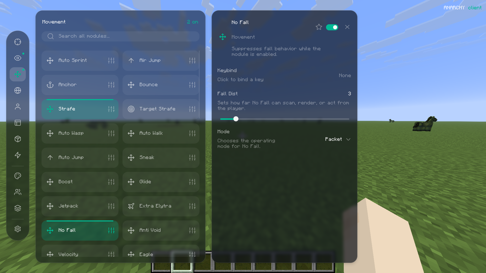

# AnarchyClient

[](https://github.com/6b6t/AnarchyClient/actions/workflows/ci.yml)
[](LICENSE)

Fabric `26.2` utility mod for 6b6t.

> [!NOTE]
> This is a fun side project by the 6b6t team, not an official product. It comes with no support guarantees. Use it at your own risk.

## Demo

Preview of how it looks in-game.



## Features

- Custom, unique in-game GUI built on a tailored Rivet interface for fast, consistent module control.
- Vulkan and OpenGL renderer support through Blaze3D.
- Gameplay focus modules: `KillAura`, `AutoTotem`, `AutoArmor`, and `AutoSprint` for combat/survival flow; `Parkour`, `NoFall`, `SafeWalk`, and `AutoEat` for movement and player consistency; `Tracers`, `ESP`/`StorageEsp`/`ItemEsp`, `CoordinatesHud`, `ActiveModulesHud`, and `HudText` for awareness and visual feedback.

## How to use 

1. Grab the latest Fabric .jar from https://github.com/6b6t/AnarchyClient/releases/latest
2. Put in your Fabric `minecraft/mods` folder.
3. Join a world
4. Open with Right-Shift click (keybind configurable in Minecraft keybind settings)

## Development

```bash
./gradlew build
./gradlew runClient
```

The client menu opens with `Right Shift`. Rivet is pulled from `com.github.Lenni0451.rivet:core:8dfcc3dd17`; upstream source is available at `https://github.com/Lenni0451/rivet`.

## License

[MIT](LICENSE)

## Local Git checks

Install [Lefthook](https://lefthook.dev/installation/) 1.13.6 or newer and Python 3.10 or newer.
Run `lefthook install` once in each clone or linked worktree.

The commit hook checks staged whitespace without rewriting or staging files.
The push hook reads Git's exact ref updates and selects existing checks for changed paths, including deletions.
New remote refs and unavailable baselines check the complete tree.
Check out the commit that you push, then commit or stash tracked and untracked changes.
This makes the working files match the pushed revision. Deletion-only pushes do not run code checks.
Hook regression tests run for pushes with changed files. Documentation changes do not compile the application. CI remains enabled.

Use the Java toolchain required by the checked-in Gradle build.
Source, resource, and Gradle changes run `./gradlew check --max-workers=6 --no-configuration-cache`.
This compiles the mod, validates its access widener, and runs JUnit tests.
The hook does not launch Minecraft, build release jars, or publish releases.

Preview the complete local check plan:

```bash
python3 scripts/check-push.py --all --dry-run --verbose
```

Run all checks against working files before committing:

```bash
python3 scripts/check-push.py --all
```

The explicit `--all` mode allows uncommitted files. Normal push hooks require a clean working tree.
